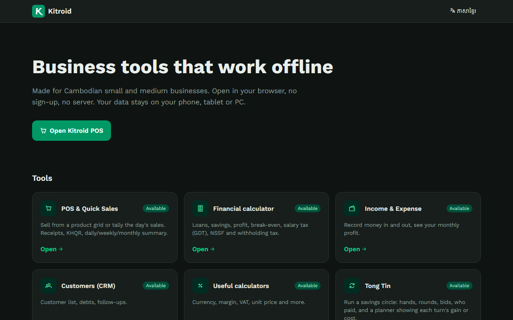
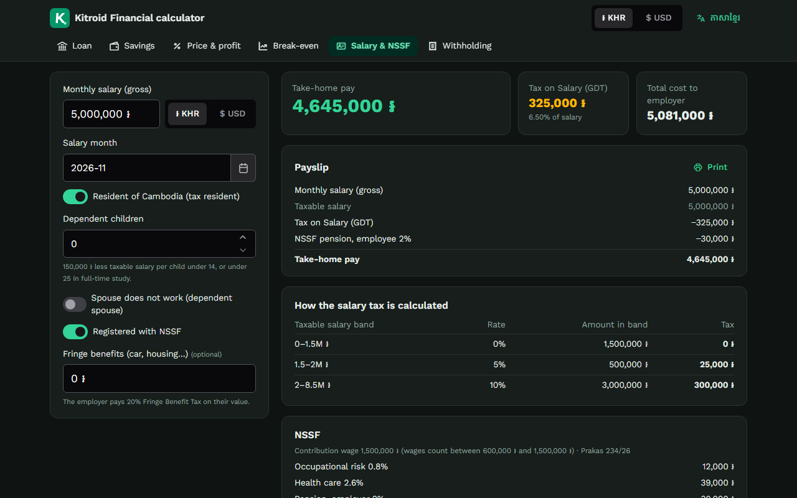

<p align="center">
  
</p>

<h1 align="center">Kitroid · ឧបករណ៍អាជីវកម្ម</h1>

<p align="center">
  <b>Free business tools for Cambodian shops, that work offline and keep your data on your own device.</b><br>
  POS and Quick Sales, income & expense, customers, salary tax & NSSF, and everyday calculators. No sign-up, no server.
</p>

<p align="center">
  <a href="https://kitroid.com"><b>▶ Open Kitroid</b></a> ·
  <a href="https://kitroid.com/pos/">POS</a> ·
  <a href="https://kitroid.com/finance/">Financial calculator</a> ·
  <a href="https://buymeacoffee.com/mtstuffs">Support us</a>
</p>

<p align="center">
  
</p>

## Why Kitroid

Most Cambodian small businesses still count sales on paper or in a notebook. Software that could help
usually needs a monthly fee, an account, a server, or a steady internet connection. Kitroid needs none of that.

- **Works offline.** Open kitroid.com once and every tool keeps working with no internet. Install it like an app on a phone, tablet or PC.
- **Your data stays with you.** Everything is stored on your own device. Nothing is sent to Kitroid. Back up to *your own* Google Drive if you want.
- **Khmer first.** Khmer and English, riel and dollar, totals rounded to the 100 ៛ note, receipts in Khmer.
- **Free.** The core of every tool is free, with no ads and no tracking.

## The tools

| Tool | What it does |
|---|---|
| 🛒 [**POS & Quick Sales**](https://kitroid.com/pos/) | Ready-made menus (café, noodles, mini-mart, salon…), sell from a product grid or tally the day's sales, cash in ៛/$ with change, KHQR, 58/80 mm receipts and Bluetooth/USB thermal printers, stock, customers who pay later, daily/weekly/monthly summary, Z-report, sync between devices through Google Drive |
| 🧮 [**Financial calculator**](https://kitroid.com/finance/) | Loans (true cost with fees, schedule), savings, price & profit, break-even, **GDT Tax on Salary + NSSF payslip**, **withholding tax** |
| 💰 [**Income & Expense**](https://kitroid.com/money/) | Cash, bank and e-wallet accounts, money in/out, receipt photos, month and year reports, CSV |
| 👥 [**Customers**](https://kitroid.com/crm/) | Contacts with phone and Telegram, follow-ups, activity log, debts per currency |
| ➗ [**Useful calculators**](https://kitroid.com/calc/) | Change in ៛/$, cash-drawer count, VAT, discount, unit price |
| 🔁 [**Tong Tin**](https://kitroid.com/tongtin/) | Savings circle (តុងទីន): winner and bid each round, who has paid, an Excel-like table |
| ❤️ [**Family health**](https://kitroid.com/health/) | Medicines with reminders, blood pressure and sugar charts, appointments, vaccines. PIN lock and encrypted backups |
| 🩺 [**Clinic**](https://kitroid.com/clinic/) | Patient queue, check-ups, prescriptions with a pharmacy QR (no diagnosis shared), fees and debts, follow-ups |
| 🧾 [**Invoices & quotes**](https://kitroid.com/invoice/) | Quotes → invoices → receipts on A4 in Khmer and English, VAT 10% (tax invoice), riel and dollar with the riel total, payments, what each client still owes, CSV for your accountant |
| 👥 [**Payroll**](https://kitroid.com/payroll/) | The whole month for all staff: tax on salary (NSSF pension deducted first), NSSF, fringe benefit tax, seniority pay, payslips and the totals for your GDT return |

<p align="center">
  
</p>

## Support Kitroid

Kitroid is free and always will be. If it helps your business, a coffee keeps new tools coming:

<a href="https://buymeacoffee.com/mtstuffs"></a>


You can also help by sharing **https://kitroid.com** with a shop owner you know, or by
[reporting a problem or idea](https://github.com/osify/kits/issues).

## Who made it

**Sok Pongsametrey** has spent nearly 20 years building software in Cambodia, including the POS system
used by LomOr & Co café, which Kitroid's Quick Sales grew out of. He also builds free tools for Khmer speakers:

- 🌐 [pongsametrey.com](https://www.pongsametrey.com)
- 💻 [OSIFY](https://osify.com): notes on code and computing since 2008, many in Khmer
- 📚 [ReanKhmer](https://rean.seuksa.com): learn to read, hear and speak Khmer

## Your data and your risk

Kitroid tools run in your browser on your own device, at your own risk. Tax, NSSF and loan results are
estimates; confirm them with GDT, NSSF, your bank or your accountant. Keep a backup. See the
[Privacy policy](https://kitroid.com/privacy/) and [Terms](https://kitroid.com/terms/).

## For developers

Static site on GitHub Pages: [Astro](https://astro.build), [Vue](https://vuejs.org),
[PrimeVue](https://primevue.org) and [Tailwind CSS](https://tailwindcss.com), with
[SQLite WebAssembly](https://sqlite.org/wasm) in the browser's private file system.

```bash
npm install
npm run dev       # http://localhost:4321
npm test          # all tool tests (sync, finance, tax, health, clinic, invoice, payroll, privacy, exchange…)
npm run build     # static site in dist/
npm run preview   # production build with the offline service worker
```

See [CLAUDE.md](CLAUDE.md) for the architecture, rules and roadmap. Pushing to `main` deploys to kitroid.com.
